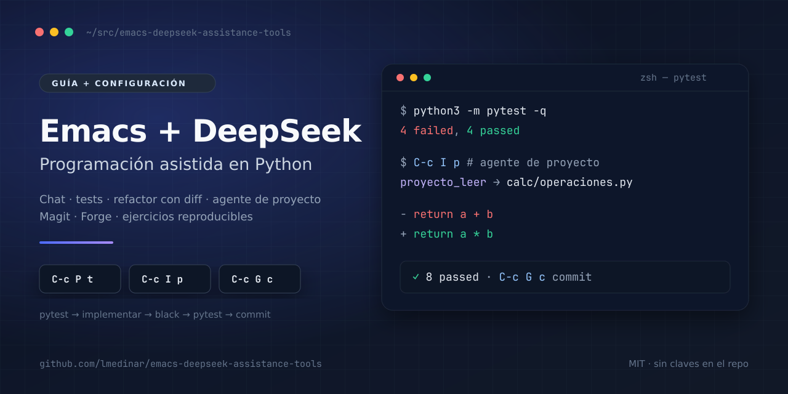
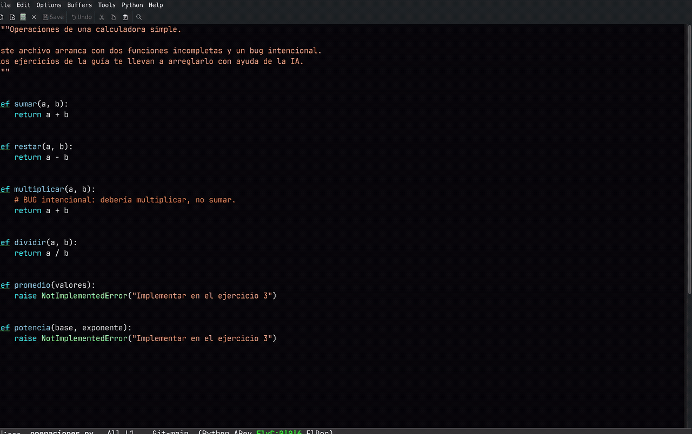

<p align="center">
  
</p>

<h1 align="center">Emacs + DeepSeek</h1>
<p align="center">Programación asistida en Python: chat, tests, refactor con diff, agente de proyecto y Git/GitHub.</p>

<p align="center">
  
  
  
  
</p>

<p align="center">
  <a href="docs/guia.pdf"><strong>📄 Guía en PDF</strong></a> ·
  <a href="https://github.com/lmedinar/emacs-deepseek-assistance-tools/raw/main/docs/guia.pdf"><strong>⬇️ PDF directo</strong></a> ·
  <a href="#demo"><strong>🎬 Ver demo</strong></a> ·
  <a href="docs/instalacion.md"><strong>⚙️ Instalación</strong></a>
</p>

> **Sin claves en el repositorio.** La API key vive en `DEEPSEEK_API_KEY` o en `~/.emacs.d/.deepseek-key`; el token de GitHub, en `~/.authinfo`.

## Demo



## Contexto y caché por proyecto

DeepSeek cachea prefijos en el servidor. Para que acierte, esta configuración mantiene un **contexto estable por proyecto** y una **sesión persistente**, ambos en `.emacs-deepseek/` (ignorado por Git):

```
mi-proyecto/
└── .emacs-deepseek/
    ├── contexto.md   ← raíz, archivos, comandos y convenciones
    └── proyecto.md   ← historial del agente
```

- `C-c I p` abre el agente; la primera vez crea `.emacs-deepseek/`.
- `contexto.md` se inyecta en **todas** las llamadas a gptel dentro del proyecto. Si no hay proyecto, la llamada es normal.
- `proyecto.md` conserva la conversación entre turnos y reinicios. `C-c I n` empieza una sesión nueva.
- La cabecera muestra tokens y caché: `[443, C1.7k↑ 78↓]` (`C1.7k` = tokens cacheados).

**Ejemplo real** (dos turnos en la misma sesión):

| Turno | Entrada | Salida | Cacheados |
|---|---|---|---|
| 1 | 1765 | 120 | 0 |
| 2 | 443 | 78 | **1664** |

La segunda llamada reutilizó 1664 tokens del prefijo. El contexto local no es la caché (esa vive en DeepSeek); es lo que hace que el prefijo se repita y la caché acierte.

```elisp
(setq ia-proyecto-contexto t)  ; contexto en todas las llamadas
(setq ia-proyecto-sesion t)    ; sesión persistente del agente
```

## Qué incluye

- **`emacs/init.el`** — configuración autocontenida (gptel + DeepSeek, LSP/Pyright, pytest, black, Magit, Forge, diff-hl, git-link).
- **`docs/guia.md`** — guía completa, desde cero, con ejercicios.
- **`docs/guia.pdf`** — la misma guía en PDF, con índice y resaltado.
- **`docs/assets/`** — hero SVG/PNG y GIF de demostración.
- **Contexto por proyecto** — `.emacs-deepseek/` (ignorado por Git) mantiene contexto y sesión; DeepSeek cachea el prefijo y abarata las llamadas.
- **`docs/instalacion.md`** — instalación paso a paso.
- **`practice/`** — proyecto de práctica (calculadora con tests en rojo).
- **`scripts/`** — instalación, token de Forge, reset y verificación, con equivalentes `.sh` y `.ps1` para Windows.

## Requisitos

| Herramienta | Qué es | Para qué |
|---|---|---|
| **Emacs 29+** | Editor | gptel, Magit, LSP y toda la guía |
| **Git** | Control de versiones | Magit, commits, ramas |
| **Python 3.10+** | Intérprete | Proyecto y tests |
| **pytest** | Ejecutor de tests | Ciclo rojo → verde |
| **black** | Formateador automático | Reescribe el código a un estilo único; no busca bugs |
| **ripgrep (`rg`)** | Buscador rápido | Lo usa el agente para explorar archivos |
| **Pyright** | Servidor de lenguaje (LSP) | Autocompletado, diagnósticos, ir a definición |
| **gh** (opcional) | GitHub CLI | Forge, PRs y CI |
| **pandoc + xelatex** (opcional) | Markdown → PDF | Regenerar `docs/guia.pdf` |

**Qué instala cada cosa:**

- `emacs/init.el` instala **paquetes de Emacs** desde MELPA (`gptel`, `lsp-mode`, `lsp-pyright`, `magit`, `forge`, etc.).
- **`scripts/install-deps.sh --yes`** (Linux/macOS) o **`scripts/setup.ps1 -Install`** (Windows) instalan las **herramientas del sistema**, `pytest`, `black` y `pyright`.
- **`scripts/setup.sh`** / **`setup.ps1`** solo **comprueban** y crean el proyecto de práctica. **No instalan nada por defecto.**

## Instalación por SO

**Debian/Ubuntu**

```bash
sudo apt update
sudo apt install emacs git ripgrep python3 python3-pip gh nodejs npm
python3 -m pip install --user pytest black
npm install -g pyright
```

**Arch Linux**

```bash
sudo pacman -S --needed emacs git ripgrep python python-pip nodejs npm github-cli
python -m pip install --user pytest black
npm install -g pyright
```

**macOS (Homebrew)**

```bash
brew install emacs git ripgrep python gh node
python3 -m pip install --user pytest black
npm install -g pyright
```

**Windows (PowerShell)**

```powershell
winget install -e --id GNU.Emacs
winget install -e --id Git.Git
winget install -e --id BurntSushi.ripgrep.MSVC
winget install -e --id Python.Python.3.12
winget install -e --id GitHub.cli
winget install -e --id OpenJS.NodeJS.LTS
py -m pip install --user pytest black
npm install -g pyright
```

O deja que el repo lo haga por ti:

- Linux/macOS: `./scripts/install-deps.sh --yes`
- Windows: `.\scripts\setup.ps1 -Install`

> En Windows usa `py` o `python`; la configuración detecta el ejecutable. Los scripts `.sh` requieren Git Bash/WSL; los equivalentes `.ps1` están incluidos.

## Inicio rápido

```bash
git clone https://github.com/lmedinar/emacs-deepseek-assistance-tools.git
cd emacs-deepseek-assistance-tools

# 1. Clave de DeepSeek (elige una)
export DEEPSEEK_API_KEY='tu-clave'
# o:
mkdir -p ~/.emacs.d
printf '%s' 'tu-clave' > ~/.emacs.d/.deepseek-key
chmod 600 ~/.emacs.d/.deepseek-key

# 2. Proyecto de práctica
./scripts/setup.sh

# 3. Emacs con esta configuración
emacs --init-directory "$PWD/emacs"
```

**Windows (PowerShell):**

```powershell
git clone https://github.com/lmedinar/emacs-deepseek-assistance-tools.git
cd emacs-deepseek-assistance-tools

# 1. Clave de DeepSeek
$env:DEEPSEEK_API_KEY = 'tu-clave'
# o:
New-Item -ItemType Directory -Force "$HOME\.emacs.d" | Out-Null
Set-Content -Path "$HOME\.emacs.d\.deepseek-key" -Value 'tu-clave' -NoNewline

# 2. Proyecto de práctica
.\scripts\setup.ps1

# 3. Emacs
emacs --init-directory "$PWD\emacs"
```

Dentro de Emacs:

1. Abre `~/src/ia-python-practica/tests/test_operaciones.py`.
2. `C-c P t` → deben fallar 4 tests.
3. Sigue `docs/guia.md`.

## Atajos

| Prefijo | Para |
|---|---|
| `C-c I` | IA: explicar, tests, implementar, revisar, refactor, docstrings, corregir, agente |
| `C-c I p` / `n` | Abrir el agente / empezar una sesión nueva |
| `C-c P` | Python: ejecutar, pytest, black, lint, REPL |
| `C-c G` | Git: status, commit, push, fetch, log, diff, rama, blame, stash, Forge |
| `C-x g` | Magit status |

## El ciclo

```
C-c P t   → tests en rojo
C-c I i   → la IA implementa
pegar     → aplicar
C-c P f   → black
C-c P t   → tests en verde
C-c I r   → revisión
C-c G c   → commit
```

## Agente de proyecto

`C-c I p` abre `*IA: proyecto*`. DeepSeek puede:

- listar, leer y buscar archivos;
- editar con **diff + confirmación**;
- crear archivos y borrar a la papelera;
- ejecutar pytest;
- consultar Git, hacer commit y push con confirmación.

Todo queda confinado a la raíz del proyecto. No hay shell libre.

## Seguridad

- No subas `~/.emacs.d/.deepseek-key`, `~/.authinfo` ni `.env`.
- El `.gitignore` ya excluye esos archivos.
- La config lee la clave así:

```elisp
(or (getenv "DEEPSEEK_API_KEY")
    (mi-leer-clave "~/.emacs.d/.deepseek-key"))
```

- Forge usa `~/.authinfo` con las entradas `usuario^forge` y `usuario^ghub`.
- Antes de publicar cambios:

```bash
grep -RInE "sk-|ghp_|password|api[_-]?key" . || true
```

## Estructura

```
.
├── docs/
│   ├── guia.md
│   └── instalacion.md
├── emacs/
│   ├── init.el
│   └── README.md
├── practice/
│   ├── calc/
│   ├── tests/
│   ├── pyproject.toml
│   └── scripts/reset.sh
├── scripts/
│   ├── setup.sh
│   ├── setup-forge.sh
│   ├── reset-practice.sh
│   └── check.sh
└── .github/workflows/ci.yml
```

## Repetir la guía

```bash
./scripts/reset-practice.sh
```

Vuelve al commit `estado-inicial`: **4 fallos, 4 aprobados**.

## Licencia

MIT. Ver [LICENSE](LICENSE).
